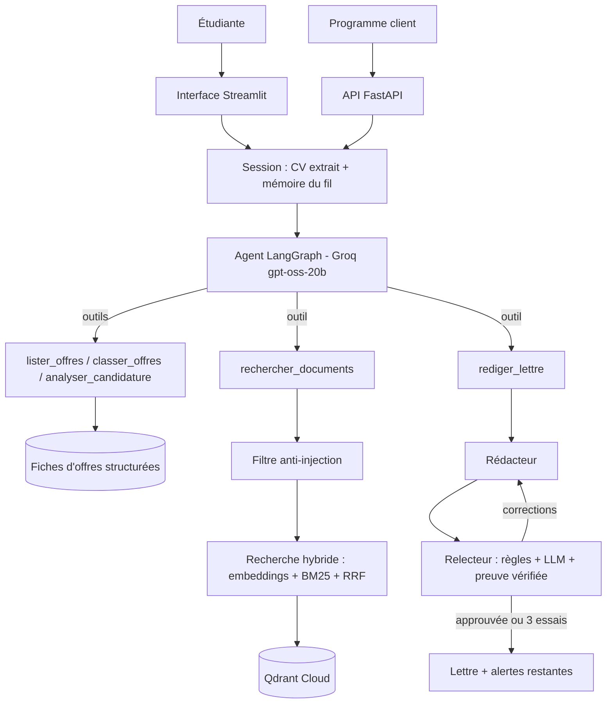

# Assistant de candidature : un agent IA complet pour préparer ses stages

Une application qui aide une étudiante à **choisir ses stages et à y postuler** : elle lit son CV, classe les offres selon son profil, répond à ses questions en citant ses sources, et rédige des lettres de motivation **relues par un second agent** qui traque les inventions.

C'est l'aboutissement de deux projets précédents, fusionnés et reconstruits avec les outils du métier :
- **Projet 1** : agent d'analyse CV / offre (sorties structurées, comparaison de compétences, sécurité) ;
- **Projet 2** : agent RAG (embeddings, recherche hybride, évaluation, injection indirecte), écrit sans framework.

Ici : **LangChain**, **LangGraph**, une base vectorielle **Qdrant Cloud**, une architecture **multi-agents**, une **évaluation** sur des cas piégés, une **interface Streamlit**, une **API FastAPI** et **Docker**.

## Ce que fait l'application

| Fonction | Comment | Appel au LLM |
|---|---|---|
| Lire un CV | extraction structurée (Pydantic), contrôle anti-injection **avant** le LLM, vérification que chaque compétence extraite est bien écrite dans le CV | 1 |
| Classer les offres | fiches d'offres structurées (compétences requises, avec alternatives « A ou B »), comparaison sémantique des compétences, taux d'exigences satisfaites | **aucun** |
| Répondre aux questions | agent LangGraph avec 5 outils et mémoire de conversation | 1 à 4 |
| Rédiger une lettre | rédacteur + relecteur (deux agents), boucle de correction, vérifications par règles | 2 à 6 |

## Architecture



**Deux graphes LangGraph :**
- **l'agent** (boucle `agent ⇄ outils`, `tools_condition`, mémoire par `thread_id` avec un checkpointer) ;
- **la relecture** (état sur mesure `TypedDict`, nœuds `preparer → rediger → relire`, arête conditionnelle qui renvoie au rédacteur ou termine, garde-fou de 3 essais).

## Principe directeur : le LLM propose, le code décide

Partout où c'est possible, la décision finale est prise par du code vérifiable :

- **Classement des offres** : calculé dans le code à partir de fiches structurées, sans LLM.
- **Lettre** : les règles vérifient la longueur, la référence de l'offre, les compétences citées (absentes du CV ?) et les nombres (absents des sources ?).
- **Relecteur** : il doit justifier chaque affirmation « soutenue » par une **citation exacte** des sources ; le code vérifie que la citation existe vraiment (`preuve_valide`). Un relecteur qui hallucine une preuve est démasqué.
- **Boucle de correction** : c'est le code (`apres_relecture`), pas le LLM, qui décide de continuer ou d'arrêter.

## Résultats clés

**Le relecteur attrape des inventions que les règles ne voient pas.** Exemples réels :
- « TelcoMed, une entreprise reconnue pour son innovation dans le secteur de la **santé** » : l'offre n'en dit rien (déduit du nom « Med ») ;
- « mes compétences en apprentissage automatique, notamment en **régression logistique et arbres de décision** » : techniques tirées de l'offre et présentées comme acquises.

**Évaluation sur des lettres piégées** : une lettre propre, puis 5 copies contenant chacune une invention d'un type différent (compétence, chiffre, jugement, entreprise, nombre écrit en lettres).

| Détection des inventions | Taux |
|---|---|
| Règles seules | 20 % (1/5 : le chiffre) |
| Relecteur seul | 60 % (3/5) |
| **Les deux réunis** | **80 % (4/5)** |

Règles et relecteur sont **complémentaires** : le relecteur a raté « réduit de 40 % », la règle sur les nombres l'a trouvé.

**Ce que l'évaluation a aussi révélé** (et que la démo cachait) : le relecteur choisissait lui-même quoi vérifier. Il listait parfois les informations de l'offre au lieu de la lettre, oubliait les phrases piégées et produisait des alertes instables. Une **V2 « phrase par phrase »** est conçue (`relecteur_phrases.py`) : le code découpe la lettre en phrases numérotées, le LLM rend un verdict par numéro, le code garantit qu'aucune phrase n'est oubliée. Elle reste à mesurer (`python scripts/etape8_evaluation.py v2`, comparée automatiquement à la V1).

## Ce que montre le projet

- **LangChain** : modèle de chat, sorties structurées (`with_structured_output`), outils (`@tool`), réessais (`with_retry`) et plan B (`with_fallbacks`).
- **LangGraph** : graphes d'agents, état, arêtes conditionnelles, mémoire par fil de conversation.
- **Base vectorielle** : Qdrant Cloud (collections, points, payloads, filtres par métadonnées, identifiants déterministes), mêmes résultats vérifiés que l'index NumPy du projet 2.
- **Multi-agents** : rédacteur et relecteur avec des rôles et des prompts différents.
- **Évaluation** : jeu de test piégé, rappel, faux positifs, vérification que l'alerte désigne la bonne phrase, sauvegarde pour la non-régression.
- **Robustesse** : erreurs de schéma de Groq (réessai, plan B à une autre température), limites de débit (attente exponentielle), un nœud qui échoue ne fait pas planter le graphe.
- **Sécurité** : détection d'injection sur le CV et sur les passages récupérés, secrets hors du code et hors de l'image Docker, utilisateur non root dans le conteneur.
- **Mise en production** : interface Streamlit, API REST (codes 201 / 404 / 422 / 503), image Docker et Compose, versions fixées.

## Stack

Python 3.12 · Groq (`openai/gpt-oss-20b`) · LangChain · LangGraph · Qdrant Cloud · sentence-transformers · rank-bm25 · Pydantic · Streamlit · FastAPI · Docker · pytest

## Installation

### Prérequis

- une clé API **Groq** (gratuite) : <https://console.groq.com>
- un cluster **Qdrant Cloud** (gratuit) : <https://cloud.qdrant.io>

Crée un fichier `.env` à la racine (il est exclu de Git et de l'image Docker) :

```
GROQ_API_KEY=...
QDRANT_URL=https://xxxx.cloud.qdrant.io:443
QDRANT_API_KEY=...
```

Le port `:443` est conseillé : certains réseaux bloquent le port 6333 utilisé par défaut.

### Avec Docker (recommandé)

```bash
docker compose up --build
```

- Interface : <http://localhost:8501>
- API (documentation interactive) : <http://localhost:8000/docs>

### Sans Docker

```bash
python -m venv .venv
# Windows : .venv\Scripts\activate    |    Linux/Mac : source .venv/bin/activate
pip install -r requirements.txt

python scripts/etape3_qdrant.py               # envoie les passages dans Qdrant (une fois)
streamlit run app.py                          # l'interface
uvicorn src.assistant.api:app --reload        # l'API
```

## API

| Route | Rôle |
|---|---|
| `GET /sante` | l'API répond-elle ? |
| `POST /sessions` | envoyer un CV → identifiant de session |
| `GET /sessions/{id}/offres` | classement des offres (sans LLM) |
| `POST /sessions/{id}/questions` | question à l'agent → réponse + outils utilisés |
| `POST /sessions/{id}/lettres` | lettre rédigée et relue → lettre, alertes, journal |

Test de l'API sans serveur : `python scripts/etape10_tester_api.py`.

## Structure

```
assistant-candidature/
├── app.py                      # interface Streamlit (affichage uniquement)
├── src/
│   ├── rag/                    # briques du projet 2 (embeddings, recherche hybride, sécurité)
│   ├── candidature/            # briques du projet 1 (extraction, comparaison, sécurité)
│   └── assistant/
│       ├── offres.py           # fiches d'offres structurées
│       ├── session.py          # session : CV extrait une fois, vérifié
│       ├── base_vectorielle.py # Qdrant Cloud
│       ├── outils_langchain.py # outils de recherche
│       ├── candidature.py      # classement et analyse
│       ├── agent_graphe.py     # l'agent LangGraph
│       ├── lettre.py           # rédaction et vérifications par règles
│       ├── multi_agents.py     # graphe rédacteur + relecteur
│       ├── evaluation.py       # lettres piégées et métriques
│       ├── relecteur_phrases.py# relecteur V2 (phrase par phrase)
│       ├── affichage.py        # fonctions d'affichage testables
│       └── api.py              # API FastAPI
├── scripts/                    # un script par étape de construction
├── data/                       # offres, guides, CV d'exemple, résultats d'évaluation
├── Dockerfile · docker-compose.yml · .dockerignore
└── requirements.txt            # versions fixées
```

## Limites et suite

- **Base d'offres locale** (3 offres d'exemple). Piste : récupérer des offres réelles par une API officielle ou une API de recherche (le scraping de LinkedIn est contraire à ses conditions d'utilisation). Le pipeline est prêt : une nouvelle source n'a qu'à fournir le texte de l'offre.
- **Relecteur instable** (voir l'évaluation) : mesurer la V2 phrase par phrase, essayer un modèle plus fort comme juge.
- **Lettres souvent trop courtes** malgré la consigne chiffrée : le rédacteur sous-estime la longueur.
- **Sessions en mémoire** : elles disparaissent au redémarrage de l'API. Piste : un stockage persistant (Redis, base de données) et un checkpointer LangGraph persistant.
- **Offre gratuite de Groq** limitée à 8 000 tokens par minute : pauses nécessaires entre les appels lourds.

